<p align="center">
  
</p>

<p align="center">
  
</p>

<p align="center">
  
  
  
  
</p>

## Overview

A machine-learning microservice that forecasts future purchasing needs from order history. It predicts order quantity and the best order date, returns a confidence score, detects trend and seasonality, and produces recommendations with urgency levels. Exposed as a documented FastAPI REST service.

## Highlights

- Order-quantity and optimal-order-date prediction
- Confidence score from 0 to 100% for every prediction
- Trend and seasonality detection
- Urgency-aware purchasing recommendations
- Batch predictions for multiple products
- Docker image, Kubernetes manifests and Render deployment guides

## Tech stack

<p align="center">
  
</p>

## Getting started

**Prerequisites:** Python 3.11+ and a trained model bundle.

```bash
python -m venv venv && source venv/bin/activate
pip install -r requirements.txt
cp .env.example .env
uvicorn app.main:app --port 8001 --reload
```

## Project structure

```text
app/        FastAPI application and ML pipelines
tests/      unit tests
k8s/        deployment manifests
render.yaml deployment blueprint
```

---

<p align="center">
  
</p>

<p align="center">
  Built by <a href="https://github.com/Skander-Bardaoui"><b>Skander Bardaoui</b></a> ·
  <a href="https://skander-bardaoui.netlify.app/">Portfolio</a> ·
  <a href="https://github.com/Skander-Bardaoui?tab=repositories">All repositories</a>
</p>
